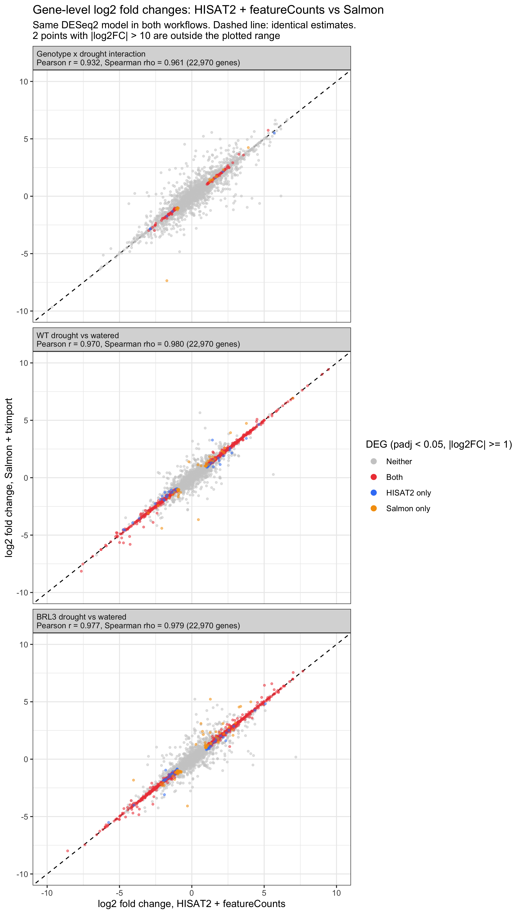

# Upstream comparison: HISAT2 + featureCounts vs Salmon + tximport

This page gives the details behind Stage 4 of the [README](../README.md). To
check whether the conclusions depend on the upstream method, I quantified the
same FASTQ files a second way and fitted the same DESeq2 model
(`~ genotype * condition`), prefilter and DEG thresholds (adjusted p-value
< 0.05, |log2 fold change| ≥ 1) to the result.

Scripts:
[`upstream_salmon_workflow.sh`](../scripts/upstream_salmon_workflow.sh) and
[`salmon_tximport_DESeq2.R`](../scripts/salmon_tximport_DESeq2.R).

## How the two workflows differ

| | HISAT2 + featureCounts | Salmon + tximport |
| --- | --- | --- |
| Reference | TAIR10 genome; GTF exon coordinates for counting | Ensembl Plants 63 cDNA + ncRNA sequences (54,013 transcripts); genome only as decoy |
| How reads are placed | Spliced alignment to the genome | Selective alignment to transcripts: k-mer matching plus alignment scoring, without a base-level alignment |
| Multi-mapping reads | Discarded by featureCounts (default) | Kept and divided between compatible transcripts by an EM algorithm |
| Strandedness | `-s 2`, chosen from a three-way test | `-l A`, detected as `SR` in every sample |
| Gene-level values | Integer counts from exon overlaps | Transcript estimates summed per gene by tximport; average transcript length passed to DESeq2 as an offset |
| Use of the GTF | Full exon coordinates | Only the transcript-to-gene table |
| Intermediate files | Sorted BAM files (about 6.4 GB) | No BAM; one `quant.sf` per sample (about 2 MB) |

Three details keep the two workflows comparable:

- **Same annotation release.** The cDNA and ncRNA files come from the same
  Ensembl Plants release as the GTF. The ncRNA file is included because
  featureCounts counted coding and non-coding genes. The shell script checks
  that all 54,013 transcript–gene pairs match the GTF, and the R script checks
  that the resulting 32,833 genes are the gene set of the featureCounts matrix.
- **Genome decoy.** A read that matches an unannotated genomic region better
  than any transcript goes to the decoy and is discarded, instead of being
  forced onto a similar transcript.
- **Duplicate transcripts kept.** Salmon by default keeps only one copy of
  transcripts with identical sequences. TAIR10 has 546 such transcripts, and
  dropping them would remove 522 genes from the output. The index is built
  with `--keepDuplicates`.

## Mapping rates

Both rates use the number of sequenced reads as the denominator
([`comparison_mapping_rates.tsv`](../results/comparison_mapping_rates.tsv)):

| | Range across 11 samples | Mean |
| --- | ---: | ---: |
| featureCounts, reads assigned to a gene | 93.2–94.8% | 94.2% |
| Salmon, reads assigned to a transcript | 95.2–96.1% | 95.7% |

Salmon was 1.4–1.9 percentage points higher in every sample, consistent with
it keeping the multi-mapping reads that featureCounts discards.

## DEG counts

All five comparisons of the factorial model
([`salmon_comparison_summary.tsv`](../results/salmon_comparison_summary.tsv)):

| Comparison | HISAT2 + featureCounts | Salmon + tximport |
| --- | ---: | ---: |
| WT drought vs watered | 1621 | 1614 |
| BRL3 drought vs watered | 2257 | 2288 |
| BRL3 vs WT under watered conditions | 539 | 544 |
| BRL3 vs WT under drought conditions | 591 | 592 |
| Genotype × drought interaction | 137 | 151 |

## Overlap and fold-change agreement

([`comparison_DEG_overlap.tsv`](../results/comparison_DEG_overlap.tsv),
[`comparison_log2FC_correlation.tsv`](../results/comparison_log2FC_correlation.tsv))

| Contrast | Shared DEGs | % of HISAT2 DEGs | % of Salmon DEGs | log2 FC Pearson r | log2 FC Spearman ρ |
| --- | ---: | ---: | ---: | ---: | ---: |
| Genotype × drought interaction | 129 | 94.2 | 85.4 | 0.932 | 0.961 |
| WT drought vs watered | 1560 | 96.2 | 96.7 | 0.970 | 0.980 |
| BRL3 drought vs watered | 2195 | 97.3 | 95.9 | 0.977 | 0.979 |

Correlations use the 22,970 genes with a fold change in both workflows. Every
shared DEG has the same direction in both. Restricted to the 154 genes that are
interaction DEGs in either workflow, Pearson r drops to 0.78, but this is
caused by a single gene (see below); without it r is 0.97, and Spearman ρ,
which is insensitive to outliers, is 0.99.

The UpSet plot
[`comparison_DEG_overlap_upset.png`](../results/comparison_DEG_overlap_upset.png)
shows how the six DEG sets (three contrasts × two workflows) overlap.

## Genes significant in only one workflow

Across the three contrasts there are 300 such gene–contrast cases
([`comparison_pipeline_specific_DEGs.tsv`](../results/comparison_pipeline_specific_DEGs.tsv),
summarized in
[`comparison_pipeline_specific_summary.tsv`](../results/comparison_pipeline_specific_summary.tsv)):

- 229 (76%) are threshold effects: the other workflow gives the same direction
  and is either significant with |log2 fold change| just below 1, or has
  |log2 fold change| ≥ 1 with an adjusted p-value just above 0.05.
- 48 were not tested in the other workflow, mostly because of low counts
  (prefilter or DESeq2 independent filtering).
- 23 have clearly different estimates. Eleven of them differ at least two-fold
  in mean counts between the workflows, which points to reads shared with
  paralogs or other similar sequences, discarded by featureCounts but divided
  up by Salmon. Isoform-rich genes are another possible source, because the
  gene-level Salmon estimate depends on how reads are divided between
  isoforms.

The clearest case is *AT2G05250* (a DNAJ heat-shock N-terminal
domain-containing protein). featureCounts assigns it 0–4 reads per sample.
Salmon assigns it 226–1,302 reads in four samples and none in the other seven,
and in the one sample I inspected most of its reads were also compatible with
other targets. The result is a log2 fold change of about ±21 that appears as
"significant" in the Salmon WT drought and interaction results. I treat this as
an artefact of how multi-mapping reads are assigned, not as a drought effect.

## Conclusion

The main results do not depend on the upstream method. The interaction overlap
is a little lower, as expected for the comparison with the fewest DEGs and the
least statistical power.

## Note on the TPM table

Salmon also gives a gene-level TPM table,
[`salmon_gene_TPM.tsv`](../results/salmon_gene_TPM.tsv). It is for display and
for comparing the expression level of different genes. It is not used for
differential expression: TPM is a relative measure that sums to one million in
every sample, so large changes in a few genes shift all the others. DESeq2
always works on the estimated counts.
